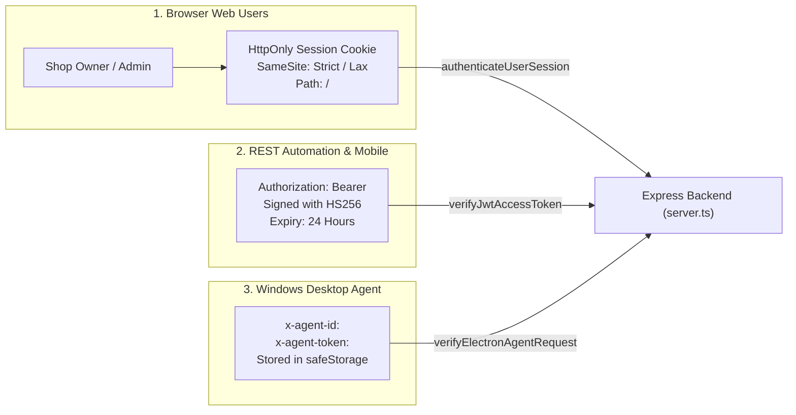

# PrintFlow Cloud: Authentication, Multi-Tenant Isolation & Desktop Agent Security

**Document Type:** Security Architecture & Cryptographic Specification  
**Verified Source Files:** `server.ts`, `src/lib/electronAgentSecurity.ts`, `src/lib/crypto/credentialCrypto.ts`, `src/lib/security.ts`  

---

## 1. Authentication Mechanisms Overview

PrintFlow Cloud implements three distinct security boundaries:



---

## 2. Machine-to-Machine (M2M) Device Authentication

### 2.1. Credential Model
- Each physical PC running the PrintFlow Agent is assigned:
  - `agentId`: Unique device string (e.g., `agent_shop_shree_ganesh` or UUID).
  - `authToken`: Unguessable high-entropy cryptographic token prefixed with `agt_tok_` (e.g., `agt_tok_sgx_live_99482`).
- Generated server-side using:
  ```typescript
  const newToken = `agt_tok_${device.shopId.replace('shop_', '')}_${crypto.randomBytes(16).toString('hex')}`;
  ```

### 2.2. Token Verification & Timing-Attack Immunity
- In `src/lib/electronAgentSecurity.ts`, `verifyElectronAgentRequest()` performs:
  1. Lookup in `electronDeviceRegistry` by `agentId`.
  2. Check `device.isRevoked === false`.
  3. Constant-time token comparison via `crypto.timingSafeEqual`:
     ```typescript
     const bufA = Buffer.from(device.authToken);
     const bufB = Buffer.from(authToken);
     if (bufA.length !== bufB.length || !crypto.timingSafeEqual(bufA, bufB)) {
       return { valid: false, error: 'Invalid agent authentication token' };
     }
     ```
  4. Tenant boundary verification: If `targetShopId` is supplied, ensures `device.shopId === targetShopId`.
  5. Refreshes `device.lastHeartbeatAt = Date.now()` and sets `device.status = 'ONLINE'`.

### 2.3. Remote Revocation & Instant Token Invalidation
- When a shop owner or platform admin rotates or revokes an agent:
  - `POST /api/agent/:agentId/rotate-token`: Generates a fresh token, replaces the old token in the registry, and immediately rejects requests signed with the previous token.
  - `POST /api/agent/:agentId/revoke`: Marks `isRevoked: true` and `status: 'SUSPENDED'`. Any ongoing polling or claim requests from the compromised machine fail immediately with `403 Forbidden`.

---

## 3. Desktop Agent OS-Backed Credential Storage (`safeStorage`)

The Electron Print Agent runs in a local Windows environment and must never store plain-text tokens in `.env`, `localStorage`, or unencrypted files.

### 3.1. Electron Process Architecture
The agent must be architected with strict process isolation:

```
┌────────────────────────────────────────────────────────┐
│               ELECTRON MAIN PROCESS                    │
│  - Node.js runtime enabled                             │
│  - Access to safeStorage / Windows DPAPI              │
│  - SQLite local database                               │
│  - Native Windows Spooler bindings (pdf-to-printer)   │
│  - Polling Engine (HTTP REST with M2M Headers)         │
└──────────────────────────┬─────────────────────────────┘
                           │ IPC Bridge (contextBridge)
                           ▼
┌────────────────────────────────────────────────────────┐
│               PRELOAD SCRIPT (SANDBOXED)               │
│  - contextIsolation: true                              │
│  - nodeIntegration: false                              │
│  - Only exposes sanitized electronAPI methods          │
└──────────────────────────┬─────────────────────────────┘
                           │ Window.electronAPI
                           ▼
┌────────────────────────────────────────────────────────┐
│               RENDERER PROCESS (REACT UI)              │
│  - Pure browser context                                │
│  - Zero direct file system access                      │
│  - Displays printer list, connection state & logs      │
└────────────────────────────────────────────────────────┘
```

### 3.2. Windows DPAPI Encryption via Electron `safeStorage`
- Electron provides `safeStorage.encryptString()` and `safeStorage.decryptString()`, which use the **Windows Data Protection API (DPAPI)**.
- The encryption key is tied to the current logged-in Windows user account and hardware TPM:
  ```typescript
  import { safeStorage } from 'electron';
  import fs from 'fs';

  // Store credentials
  export function storeAgentCredentials(agentId: string, authToken: string, shopId: string) {
    const payload = JSON.stringify({ agentId, authToken, shopId });
    if (safeStorage.isEncryptionAvailable()) {
      const encrypted = safeStorage.encryptString(payload);
      fs.writeFileSync(configFilePath, encrypted);
    } else {
      throw new Error('OS hardware encryption not available');
    }
  }

  // Retrieve credentials
  export function loadAgentCredentials() {
    const buffer = fs.readFileSync(configFilePath);
    const decrypted = safeStorage.decryptString(buffer);
    return JSON.parse(decrypted);
  }
  ```

---

## 4. Multi-Tenant Isolation & BOLA/IDOR Defense

### 4.1. Server-Side Tenant Enforcement
To prevent a malicious or compromised shop agent from downloading documents belonging to another shop, `server.ts` enforces strict tenant isolation on the file download endpoint:

```typescript
// server.ts lines 1628-1637
else if (agentToken && agentId) {
  const agentCheck = verifyElectronAgentRequest({
    agentId,
    authToken: agentToken,
    targetShopId: shopId // Enforces that the downloaded file's shopId matches agent's shopId
  });
  if (!agentCheck.valid) {
    return res.status(403).json({
      success: false,
      error: `Agent Access Denied: ${agentCheck.error}`
    });
  }
}
```

### 4.2. Short-Lived HMAC-SHA256 Download Tokens
- Download URLs generated upon upload contain signed tokens:
  ```
  /api/storage/files/:shopId/:jobId/:fileId?token=1728867600.a3f9e2...
  ```
- Signature is verified with `STORAGE_SIGN_SECRET` over `${shopId}|${cleanJobId}|${fileId}|${expiresAt}`.
- Expiration is set to 1 hour (3600 seconds). Expired tokens are rejected with `403 Download token has expired`.

### 4.3. Document Sanitization & Spooler Cleanup
- When the Windows Agent downloads a document, it must store it in an isolated temporary directory (e.g. `%TEMP%\PrintFlowAgent\spool\`).
- Immediately upon completion (or failure) of the physical print job, the agent must overwrite/unlink the temporary file to prevent customer document accumulation on the counter PC.
