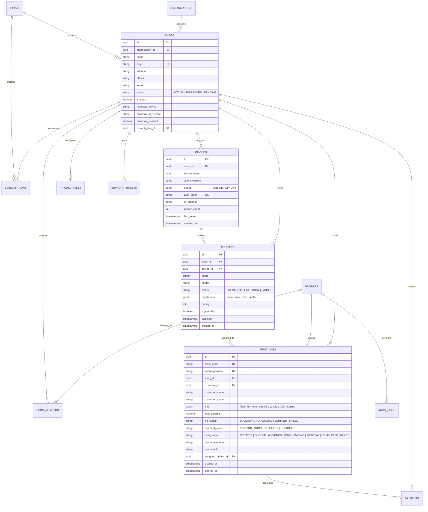

# PrintFlow Cloud: Database Schema & Entity Relationships

**Document Type:** Database Schema Reference & Entity Relationship Diagram  
**Source Files:** `supabase/migrations/001_initial_schema.sql`, `src/db/paymentStorage.ts`  
**Database Engine:** PostgreSQL (Supabase / Neon Compatible)  

## Connecting the local server to Neon

Set `DATABASE_URL` in the root `.env` file to the Neon connection string, then restart the PrintFlow server with `npm run dev`. Keep this variable server-only; do not expose it through a `VITE_` variable or commit `.env`.

The server verifies the connection and initializes its PrintFlow Agent/payment and app-state tables at startup. The React store keeps a browser-local copy and synchronizes the supported shop, pricing, printer, agent, job, transaction, subscription, plan, policy, audit, and support state with Neon through authenticated server routes. Existing browser state is uploaded when Neon has no saved state for that shop. Set `PRINTFLOW_LEGACY_SHOP_ID` and `PRINTFLOW_NEON_SHOP_ID` to map the demo shop to the canonical Neon shop; the target shop must already exist in `shops`.

App state is stored as JSONB in `printflow_app_state`, scoped to the canonical shop ID (or the platform scope for admin-only state). Server-side role checks prevent shop owners from reading or writing platform-wide state or another shop's records. Passwords, user/auth records, API/payment credentials, and embedded data-URL file contents are intentionally excluded from this generic state sync. Customer-uploaded file storage is not yet connected to Supabase; configure it only after the Supabase URL and required credentials are supplied.

Electron does not connect to Neon directly and never receives `DATABASE_URL`. It talks to the authenticated PrintFlow server API; agent printer registration, queued job metadata/status, and private print-file bytes are persisted by the server in `print_agent_devices`, `print_agent_jobs`, and `print_agent_job_files`. Pair the agent using the shop ID that exists in Neon and use the same shop ID when creating web print jobs.

---

## 1. Entity Relationship Diagram (ERD)

---

## 2. Table Definitions Relevant to the Print Agent

### 2.1. `public.devices` (Desktop Agent Registration)
Stores the identity of physical counter PCs running the Electron Print Agent.

| Column | Data Type | Constraints | Description |
|---|---|---|---|
| `id` | `UUID` | `PRIMARY KEY DEFAULT uuid_generate_v4()` | Unique device agent identifier |
| `shop_id` | `UUID` | `NOT NULL REFERENCES public.shops(id) ON DELETE CASCADE` | Associated tenant shop |
| `device_name` | `TEXT` | `NOT NULL` | Machine hostname (e.g. `COUNTER-PC01`) |
| `agent_version` | `TEXT` | `NOT NULL DEFAULT 'v1.0.0'` | Running Electron agent semver |
| `status` | `TEXT` | `NOT NULL CHECK (status IN ('ONLINE', 'OFFLINE'))` | Current connection status |
| `auth_token` | `TEXT` | `NOT NULL UNIQUE` | M2M Bearer authentication token |
| `ip_address` | `TEXT` | `NULLABLE` | Local LAN or WAN IP address |
| `printer_count` | `INT` | `NOT NULL DEFAULT 0` | Count of detected Windows printers |
| `last_seen` | `TIMESTAMPTZ` | `NULLABLE` | Timestamp of most recent heartbeat |
| `created_at` | `TIMESTAMPTZ` | `NOT NULL DEFAULT now()` | Enrollment timestamp |

- **Indexes:** `idx_devices_shop_status ON public.devices (shop_id, status)`

---

### 2.2. `public.printers` (Hardware Profiles)
Stores the physical and network printers discovered or configured for each shop.

| Column | Data Type | Constraints | Description |
|---|---|---|---|
| `id` | `UUID` | `PRIMARY KEY DEFAULT uuid_generate_v4()` | Unique printer identifier |
| `shop_id` | `UUID` | `NOT NULL REFERENCES public.shops(id) ON DELETE CASCADE` | Associated tenant shop |
| `device_id` | `UUID` | `REFERENCES public.devices(id) ON DELETE SET NULL` | Controlling Electron Agent device |
| `name` | `TEXT` | `NOT NULL` | Printer name in Windows (e.g. `Canon iR2520 UFRII LT`) |
| `model` | `TEXT` | `NULLABLE` | Printer hardware model / driver string |
| `status` | `TEXT` | `NOT NULL CHECK (status IN ('ONLINE', 'OFFLINE', 'BUSY', 'PAUSED'))` | Spooler status |
| `capabilities` | `JSONB` | `NOT NULL DEFAULT '{"paperSizes":["A4"],"color":false,"duplex":true}'` | Supported capabilities JSON |
| `priority` | `INT` | `NOT NULL DEFAULT 1` | Dispatch priority rank |
| `is_enabled` | `BOOLEAN` | `NOT NULL DEFAULT true` | Active toggle for queue assignment |
| `last_seen` | `TIMESTAMPTZ` | `NULLABLE` | Last telemetry ping |
| `created_at` | `TIMESTAMPTZ` | `NOT NULL DEFAULT now()` | Registration timestamp |

- **Indexes:** `idx_printers_shop_status ON public.printers (shop_id, status)`

---

### 2.3. `public.print_jobs` (Print Orders & Spooling Queue)
Stores every customer print order from creation through physical print completion.

| Column | Data Type | Constraints | Description |
|---|---|---|---|
| `id` | `UUID` | `PRIMARY KEY DEFAULT uuid_generate_v4()` | Database internal UUID |
| `order_code` | `TEXT` | `NOT NULL UNIQUE` | Human-readable identifier (e.g. `PRT-1024`) |
| `tracking_token` | `TEXT` | `NOT NULL UNIQUE` | Secure token for customer live tracking |
| `shop_id` | `UUID` | `NOT NULL REFERENCES public.shops(id) ON DELETE CASCADE` | Target fulfillment shop |
| `customer_id` | `UUID` | `REFERENCES public.profiles(id) ON DELETE SET NULL` | Optional authenticated customer |
| `customer_name` | `TEXT` | `NOT NULL` | Customer name (defaults to "Counter Customer") |
| `customer_phone` | `TEXT` | `NULLABLE` | Customer contact mobile number |
| `customer_email` | `TEXT` | `NULLABLE` | Customer contact email |
| `files` | `JSONB` | `NOT NULL DEFAULT '[]'` | Array of `FilePrintConfig` objects with paths |
| `total_amount` | `NUMERIC(10,2)` | `NOT NULL` | Total order amount in INR |
| `file_status` | `TEXT` | `CHECK (file_status IN ('UPLOADING', 'UPLOADED', 'VERIFIED', 'FAILED'))` | Binary integrity status |
| `payment_status` | `TEXT` | `CHECK (payment_status IN ('PENDING', 'SUCCESS', 'FAILED', 'REFUNDED'))` | Verified gateway status |
| `print_status` | `TEXT` | `CHECK (print_status IN ('CREATED', 'QUEUED', 'ASSIGNED', 'DOWNLOADING', 'PRINTING', 'COMPLETED', 'FAILED', 'CANCELLED'))` | Spooler lifecycle status |
| `payment_method` | `TEXT` | `NOT NULL DEFAULT 'DEMO'` | Payment method descriptor |
| `payment_id` | `TEXT` | `NULLABLE` | Verified Razorpay Payment ID |
| `assigned_printer_id` | `UUID` | `REFERENCES public.printers(id) ON DELETE SET NULL` | Target printer assigned for execution |
| `notes` | `TEXT` | `NULLABLE` | Customer or shop special instructions |
| `created_at` | `TIMESTAMPTZ` | `NOT NULL DEFAULT now()` | Order timestamp |
| `updated_at` | `TIMESTAMPTZ` | `NOT NULL DEFAULT now()` | Last status transition |
| `expires_at` | `TIMESTAMPTZ` | `NOT NULL` | File retention cutoff (default: 48 hours) |

- **Indexes:**
  - `idx_print_jobs_shop_status ON public.print_jobs (shop_id, print_status)`
  - `idx_print_jobs_shop_created ON public.print_jobs (shop_id, created_at DESC)`
  - `idx_print_jobs_tracking_token ON public.print_jobs (tracking_token)`
  - `idx_print_jobs_order_code ON public.print_jobs (order_code)`

---

### 2.4. `public.shops` (Tenant Information)
Contains shop settings, slug, contact information, business hours, and Razorpay configuration.

- Key columns: `id`, `name`, `slug`, `status` (`ACTIVE`, `SUSPENDED`, `PENDING`), `razorpay_key_id`, `razorpay_key_secret`, `current_plan_id`.

---

### 2.5. `public.plans` & `public.subscriptions` (SaaS Entitlements)
Contains SaaS plan quotas enforced during printer registration and agent connections:
- `printer_limit`: Maximum number of printers allowed per shop.
- `print_limit`: Maximum monthly print jobs.
- `storage_limit_gb`: Private document retention quota.
