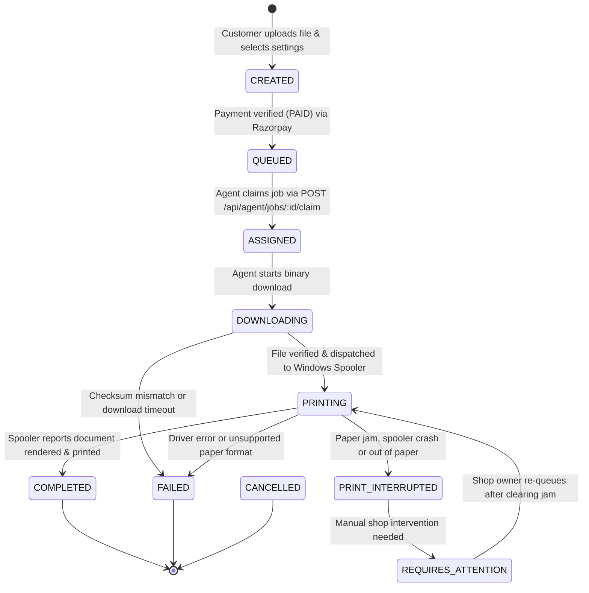

# PrintFlow Cloud: Electron Print Agent Integration Contract

**Document Type:** Desktop Agent Integration Contract & Spooler Specification  
**Target Platform:** Windows 10 / Windows 11 (64-bit)  
**Framework:** Electron.js + TypeScript + React/Vite Desktop Dashboard  

---

## Current implementation notice

This document describes the intended integration contract; it is not a claim that every mechanism below is implemented. The current customer path queues documents only after a payment is verified by the backend, through `POST /api/customer/print-jobs`. The agent downloads all files in a claimed job through its M2M-authenticated file route. The backend job queue and private file buffers are in-memory and are lost on backend restart. The Windows agent currently uses the file type's registered Windows `PrintTo` handler; it does not guarantee that copies, color, duplex, or orientation settings are applied. Do not treat the aspirational spooler, database, and zero-loss examples below as current capabilities.

---

## 1. Print Job State Machine



### Verified State Enums in Source Code:
From `src/types/index.ts`:
- `CREATED`: Initial order record before payment confirmation.
- `QUEUED`: Verified paid order waiting in shop queue for an online agent.
- `ASSIGNED`: Job claimed by a specific counter PC agent.
- `DOWNLOADING`: Binary payload currently streaming to the desktop agent.
- `PRINTING`: Document dispatched to the local Windows print spooler.
- `COMPLETED`: Physical printing finished successfully.
- `FAILED`: Terminal printing or driver error.
- `PRINT_INTERRUPTED`: Spooler paused or hardware alert.
- `REQUIRES_ATTENTION`: Out of paper, paper jam, or offline printer.
- `CANCELLED`: Order cancelled by shop owner or customer refund.

---

## 2. Windows Printer Discovery & Hardware Management

### 2.1. Native Printer Discovery
In the Electron Main process, printers are queried using either:
1. Electron's built-in WebContents printing API:
   ```typescript
   import { webContents } from 'electron';
   const winPrinters = await win.webContents.getPrintersAsync();
   ```
2. Or native Windows PowerShell WMI / CIM query:
   ```powershell
   Get-Printer | Select-Object Name, DriverName, PortName, PrinterStatus, Default
   ```

### 2.2. Discovered Printer Data Structure
The discovered printer list is mapped into the `PrinterDevice` interface (`src/types/index.ts`):
```json
{
  "id": "printer_win_canon_ir2520",
  "shopId": "shop_shree_ganesh",
  "deviceId": "agent_shop_shree_ganesh",
  "name": "Canon iR2520 UFRII LT",
  "model": "Canon UFR II LT",
  "status": "ONLINE",
  "capabilities": {
    "paperSizes": ["A4", "A3", "Legal"],
    "supportsColor": false,
    "supportsDuplex": true,
    "color": false,
    "duplex": true
  },
  "priority": 1,
  "isEnabled": true,
  "lastSeen": "2026-10-14T05:00:00.000Z"
}
```

---

## 3. Print Settings Translation & Windows Spooling

When executing a print job, the agent translates the web customer's `FilePrintConfig` into native Windows print parameters:

| Web Setting (`FilePrintConfig`) | Supported Values | Windows Spooler Parameter (`pdf-to-printer` / Win32) | Fallback / Behavior |
|---|---|---|---|
| `paperSize` | `A4`, `A3`, `Legal`, `Letter` | `paperSize: 'A4'` | If unsupported by driver, fallback to default tray paper |
| `colorMode` | `BW`, `COLOR` | `monochrome: true` / `false` | If B&W requested on color printer, force monochrome output |
| `sides` | `SINGLE`, `DOUBLE` | `duplex: 'duplexlong'` / `duplexshort` / `'simplex'` | Simplex if printer lacks duplex hardware |
| `copies` | Integer `1` to `100` | `copies: fileConfig.copies` | Loop sequential copies if driver doesn't support batching |
| `pageSelection` | `ALL` or Custom (e.g. `1-3, 5`) | `pages: '1-3, 5'` | Extract matching pages or specify in spooler command |
| `orientation` | `PORTRAIT` or `LANDSCAPE` | `orientation: 'portrait'` / `'landscape'` | Passed directly to spooler |

### Silent Execution via `pdf-to-printer`
```typescript
import { print } from 'pdf-to-printer';

export async function executeSilentPrint(options: {
  filePath: string;
  printerName: string;
  copies: number;
  sides: 'SINGLE' | 'DOUBLE';
  paperSize: string;
  color: 'BW' | 'COLOR';
}) {
  const printOptions: any = {
    printer: options.printerName,
    copies: options.copies,
    paperSize: options.paperSize
  };

  if (options.sides === 'DOUBLE') {
    printOptions.side = 'duplex';
  } else {
    printOptions.side = 'simplex';
  }

  if (options.color === 'BW') {
    printOptions.monochrome = true;
  }

  await print(options.filePath, printOptions);
}
```

---

## 4. Crash Recovery & Local SQLite Queue

To guarantee **zero lost jobs** and **zero duplicate prints** during network disconnections or PC reboots, the Electron agent must maintain a local SQLite database (using `better-sqlite3`):

### Local Schema:
```sql
CREATE TABLE IF NOT EXISTS local_jobs (
  id TEXT PRIMARY KEY,           -- PRT-XXXXX
  shop_id TEXT NOT NULL,
  file_id TEXT NOT NULL,
  local_file_path TEXT,
  target_printer TEXT NOT NULL,
  print_status TEXT NOT NULL,    -- CLAIMED, DOWNLOADED, SPOOLED, FINISHED
  spool_job_id INTEGER,
  attempt_count INTEGER DEFAULT 0,
  created_at INTEGER NOT NULL,
  updated_at INTEGER NOT NULL
);
```

### Recovery Logic on Windows Startup:
1. Agent launches on Windows boot (via Windows Registry `Software\Microsoft\Windows\CurrentVersion\Run`).
2. Checks local SQLite database for jobs with `print_status IN ('CLAIMED', 'DOWNLOADED')`.
3. Verifies with backend: Calls `GET /api/agent/jobs/:id` or status API to verify whether the job was marked completed elsewhere.
4. If still pending, re-verifies physical spooler queue before respooling to prevent double printing.
5. Deletes local file buffers once print completion is confirmed.
