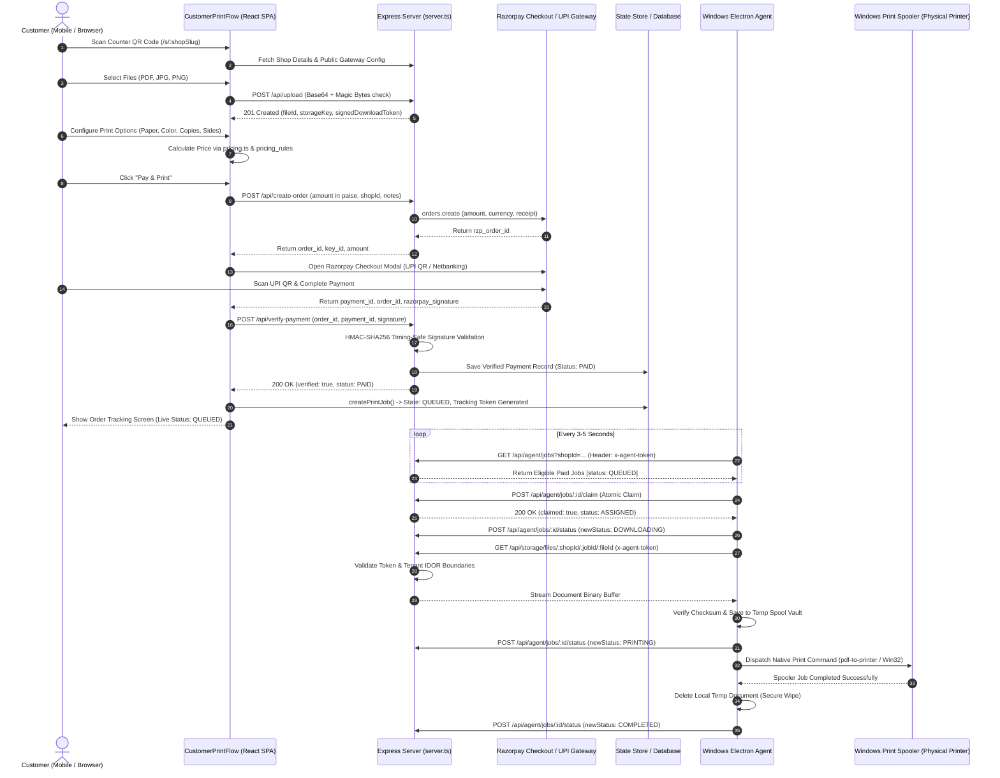

# PrintFlow Cloud: Complete Print Order Lifecycle

**Document Type:** End-to-End Workflow Specification  
**Scope:** From Customer QR Scan to Windows Physical Print Output  
**Verified Source Files:** `src/components/customer/CustomerPrintFlow.tsx`, `server.ts`, `src/lib/store.tsx`, `src/lib/utils/pricing.ts`  

---

## 1. End-to-End Sequence Diagram

---

## 2. Step-by-Step Technical Lifecycle

### Step 1: Shop Access via Counter QR Code or URL
- **Route:** `/s/:shopSlug` (rendered by `CustomerPrintFlow.tsx`).
- **Mechanism:** The customer scans a physical counter QR code generated in `ShopQrCodes.tsx`. The shop slug resolves against `shops` table/state to load the shop's pricing matrix, brand color, business hours, and Razorpay configuration.

### Step 2: File Upload & Validation
- **Action:** Customer drops PDF, PNG, or JPEG files.
- **Client Validation:** File size limit checked (standard 50MB per file; plan-entitlement dependent).
- **Endpoint:** `POST /api/upload`
- **Security Check:** `validateUploadFile()` in `server.ts` verifies:
  1. Maximum size limit (50MB).
  2. Magic-byte signature checking (e.g. `%PDF` for PDF, `\xFF\xD8\xFF` for JPEG, `\x89PNG` for PNG). Mismatched MIME extensions (e.g., an `.exe` disguised as `.pdf`) are rejected with `400 Bad Request`.
  3. Filename sanitization (removes path traversal sequences `../`, null bytes, control characters).
- **Result:** Returns `fileId`, `storageKey`, `signedDownloadToken`, and relative `downloadUrl`.

### Step 3: Print Options & Dynamic Pricing
- **Component:** `CustomerPrintFlow.tsx` step 2.
- **Inputs:** Paper Size (`A4`, `A3`, `Letter`, `Legal`), Color Mode (`BW`, `COLOR`), Sides (`SINGLE`, `DOUBLE`), Copies (`1..100`), Pages per Sheet (`1`, `2`, `4`), Page Range (`ALL` or Custom e.g. `1-5, 8`).
- **Calculation:** Evaluated by `calculateFilePrintCost()` in `src/lib/utils/pricing.ts` against the shop's configured `pricing_rules`. Total price is calculated and rounded to 2 decimal places.

### Step 4: Payment Order Creation
- **Endpoint:** `POST /api/create-order` (or `/api/payment/create-order`).
- **Inputs:** `amount` (total in Rupees or Paise), `currency: "INR"`, `shopId`, `notes`.
- **Backend Action:**
  - Evaluates whether the payment goes to the Platform Admin account or the Shop Owner's connected Razorpay account.
  - Queries `getShopPaymentIntegration(shopId)` or fallback platform keys.
  - Calls `razorpay.orders.create({ amount: amountInPaise, currency: 'INR', receipt: ... })`.
  - Caches the order in `trackedPaymentOrders` with `status: "CREATED"`.
- **Output:** Returns `{ success: true, order_id: "order_...", key_id: "rzp_...", amount: ... }`.

### Step 5: Customer Payment & Razorpay Checkout
- **Component:** `RazorpayCheckoutModal.tsx` or inline Razorpay Checkout SDK (`https://checkout.razorpay.com/v1/checkout.js`).
- **Flow:** Customer selects UPI (Google Pay, PhonePe, Paytm, BHIM) or scans the dynamic UPI QR code rendered inside the Razorpay modal.
- **Callback:** Upon completion, Razorpay returns:
  - `razorpay_payment_id`: e.g. `pay_P12345678`
  - `razorpay_order_id`: e.g. `order_O12345678`
  - `razorpay_signature`: HMAC-SHA256 signature generated by Razorpay.

### Step 6: Server-Side Signature Verification & Status Update
- **Endpoint:** `POST /api/verify-payment`
- **Backend Action:**
  - Recomputes expected signature: `HMAC_SHA256(order_id + "|" + payment_id, secret)`.
  - Performs constant-time comparison via `crypto.timingSafeEqual` to thwart timing attacks.
  - Records the verified transaction in `verifiedPayments` with status `"PAID"`.
  - Updates `trackedPaymentOrders` state to `"PAID"`.
- **Output:** Returns `{ success: true, verified: true, status: "PAID" }`.

### Step 7: Print Job Creation & Queuing
- **Function:** `createPrintJob()` in `src/lib/store.tsx`.
- **Database Record:**
  - `id`: `PRT-XXXXX`
  - `tracking_token`: Unguessable alphanumeric token (`tr_...`) for guest customer progress tracking.
  - `shop_id`: Shop identifier.
  - `payment_status`: `"SUCCESS"`
  - `print_status`: `"QUEUED"`
  - `files`: Serialized JSON array of files and their print configurations.
  - `assigned_printer_id`: Auto-selected based on active online shop printers.

### Step 8: Electron Agent Job Discovery & Claiming
- **Discovery Endpoint:** `GET /api/agent/jobs?shopId=...`
  - Requires `x-agent-token` and `x-agent-id` headers.
  - Server verifies that the agent is registered, online, and not revoked.
  - Returns jobs matching the shop ID with `print_status: "QUEUED"` and `payment_status: "SUCCESS"`.
- **Atomic Claim Endpoint:** `POST /api/agent/jobs/:id/claim`
  - Atomically marks the job as `ASSIGNED` to `agentId` to ensure no two devices or threads print the same file.

### Step 9: Secure Document Download
- **Endpoint:** `GET /api/storage/files/:shopId/:jobId/:fileId?token=...`
- **Authorization:** Either signed token in query string or `x-agent-token` + `x-agent-id` headers.
- **Tenant Isolation Check:** Server validates that `x-agent-id` belongs to `:shopId`. If valid, the binary buffer is streamed with `Content-Type: application/pdf` or image MIME.

### Step 10: Physical Printing & Status Reporting
- **Agent Action:** Dispatches document to local Windows printer using Windows Print Spooler APIs (e.g. `pdf-to-printer` or PowerShell `Start-Process -FilePath ... -Verb PrintTo`).
- **Status Updates via `POST /api/agent/jobs/:id/status`:**
  1. `DOWNLOADING`: File being retrieved.
  2. `PRINTING`: Sent to the physical printer spooler.
  3. `COMPLETED`: Spooler confirms job processed.
  4. `FAILED`: Spooler or hardware error encountered.
- **Cleanup:** Agent deletes the temporary downloaded file immediately from disk to ensure zero customer document leakage.
